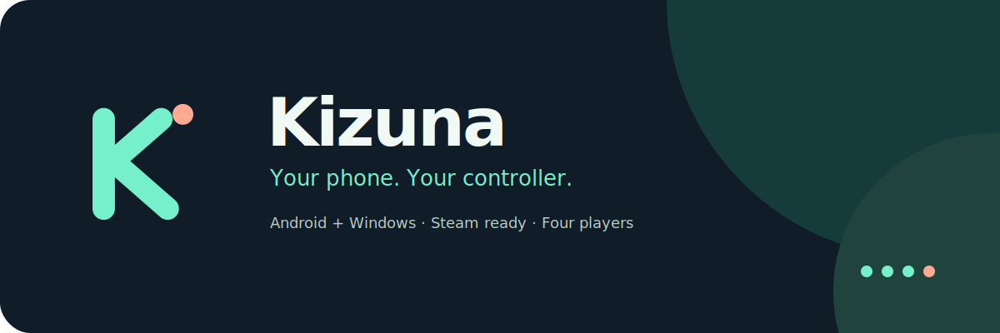

<div align="center">



**Your phone. Your controller.**

A customisable phone gamepad for **Android + Windows**.<br>
Play over your local network, build a layout for each game, and connect up to four phones at once.

<p>
  <a href="https://github.com/Chowdhury-Siam/Kizuna/releases/latest"></a>
  <a href="LICENSE"></a>
  
  
</p>

[**Download Latest**](https://github.com/Chowdhury-Siam/Kizuna/releases/latest) · [**Game Presets**](docs/GAME_PRESETS.md) · [**Build & Release**](docs/RELEASING.md) · [**Report a Bug**](https://github.com/Chowdhury-Siam/Kizuna/issues)

</div>

> [!TIP]
> **No account, subscription or cloud relay is needed to play.** Install the Windows server and ViGEmBus driver, put both devices on the same network, and select your PC in Kizuna.

---

## 🧭 Explore

- [Meet Kizuna](#meet-kizuna)
- [Features](#features)
- [Get started](#get-started)
- [Your games and profiles](#your-games-and-profiles)
- [Layout editor and touchpad](#layout-editor-and-touchpad)
- [Four players](#four-players)
- [Windows dashboard](#windows-dashboard)
- [Automatic updates](#automatic-updates)
- [Development](#development)
- [Publishing](#publishing)
- [Troubleshooting](#troubleshooting)
- [Credits and license](#credits-and-license)

---

## ✨ Meet Kizuna

Kizuna turns your Android phone into a virtual Xbox 360 controller on Windows. Your touches travel over UDP to the existing ViGEmBus backend. Windows games and Steam receive standard XInput controls.

Kizuna continues the droidOSS codebase with a new identity, an original mint-and-coral logo, and the same compatible 20-byte input protocol. It retains device discovery, four-player sessions, Steam functionality, rumble, console mode and existing layout imports. Original authorship and GPL notices remain in the source.

---

## 💎 Features

| Feature | What you can do |
| --- | --- |
| **Expressive Android UI** | Use compact Material 3 screens, spring motion and system/light/dark themes |
| **Complete gamepad** | Use two sticks, D-pad, ABXY, shoulders, triggers, stick clicks, Back and Start |
| **Editable controls** | Drag, resize, recolor, hide, duplicate, remap, align and layer controls; undo/redo or reset |
| **Joystick or touchpad** | Turn either stick into a relative touchpad, with independent 0.25×–4× sensitivity |
| **58 game presets** | Start with eFootball, Tomb Raider, Resident Evil and Steam genre profiles |
| **Saved profiles** | Keep 50 custom profiles alongside Default; rename, duplicate, import/export or share by QR |
| **Input tuning** | Save sensitivity, radial deadzones, response curves, calibration, trigger travel and vibration per profile |
| **Four phones** | Choose friendly device names and player preferences; see free slots and reconnect status |
| **Windows diagnostics** | Inspect player cards, packet rates, input age, live input and connection logs |
| **Stable updates** | Check automatically, download verified packages and start installation from the app |

---

## 🚀 Get Started

### Download and install

Choose the packages from [the latest stable release](https://github.com/Chowdhury-Siam/Kizuna/releases/latest).

| Platform | Package | Installation |
| --- | --- | --- |
| **Android 8+** | `Kizuna-v<version>-android.apk` | Open the signed APK and follow Android's installation prompt |
| **Windows x64** | `Kizuna-v<version>-Setup.exe` | Run the per-user installer; an optional desktop shortcut is available |
| **Windows portable** | `Kizuna-v<version>-win-x64.zip` | Extract all files together and run `Kizuna.exe` |
| **Source** | `Kizuna-v<version>-source.zip` | Build or modify the corresponding GPL source |

Windows packages bundle .NET.

### Required Windows driver: ViGEmBus

> [!IMPORTANT]
> **ViGEmBus must be installed on the Windows PC for Kizuna to create virtual Xbox controllers.** Neither the Kizuna Setup EXE nor the portable ZIP installs this driver automatically.

1. Open the [official ViGEmBus download page](https://github.com/nefarius/ViGEmBus/releases/latest) and download its Windows installer.
2. Run that installer **on your Windows PC** and approve the administrator prompt.
3. Restart the PC if the installer asks, then open Kizuna again.

Install the driver **only once**. If ViGEmBus is already installed and working, keep it; Kizuna updates do not require reinstalling it. **No driver installation is needed on Android.**

Release links become available after publishing this source to the intended GitHub repository. Actions builds embed their actual repository automatically, so forks get their own update channel.

### First connection

1. Start **Kizuna** on Windows. Allow its UDP traffic on your private network.
2. Open **Kizuna** on your phone, connected to the same router or hotspot.
3. Choose a device name and **Auto** or a free **P1–P4** slot.
4. Tap your PC in **Servers on this network**, or enter the address shown in the Windows app.
5. Launch a game. Use **Gamepad diagnostics** (`joy.cpl`) to check the controls first if needed.

### Moving from droidOSS

Kizuna uses a new Android application ID, `io.github.chowdhurysiam.kizuna`, and installs alongside droidOSS. **Export the layouts you want from the old app and import them into Kizuna before removing it.** Both apps keep their own private data. Old layout files, QR payloads and protocol messages continue to work. Kizuna exports `.kizuna.json` files.

The Windows server retains the legacy settings path so your existing theme/diagnostics preferences remain available. Existing droidOSS servers and phones remain protocol-compatible.

---

## 🎮 Your Games and Profiles

Open **Game profiles → Game presets**. Search by title or filter **Football**, **Tomb Raider**, **Resident Evil** or **Steam**. Tap a preset to create and activate an editable copy.

- **eFootball / PES / EA SPORTS FC**: lower movement deadzones, quick directional response and full digital trigger presses.
- **Tomb Raider**: classic and remastered I–VI, Legend/Anniversary/Underworld, the survivor trilogy and Lara Croft spin-offs. Adventure and aim profiles use different camera tuning.
- **Resident Evil**: classic and HD titles, numbered modern games through Requiem, remakes, Revelations and selected spin-offs. Aim profiles enlarge the right-stick area and reduce its gain for finer motion.
- **Steam genres**: Standard, Racing, Shooter and Platformer. Racing enables sliding analog triggers.

These are tuned **starting profiles**, not game patches, macros, automatic game detection or guaranteed game-specific bindings. Keep the game's standard Xbox controls, then adjust in-game sensitivity and Kizuna settings to taste. Older PC ports and console-only classics can require a Steam Input keyboard/legacy template or emulator mapping; each affected preset shows guidance. Mobile-only games are not controlled directly by this PC gamepad.

See [the preset guide](docs/GAME_PRESETS.md) for control behavior and compatibility notes. No commercial game's artwork or logo is bundled.

---

## 🛠️ Layout Editor and Touchpad

Create or duplicate a custom profile, then choose **Edit**. The compact toolbar keeps **Controls**, undo/redo, reset and Save available above the preview. Select a control to open **Style**, **Input** or **Arrange** in the inspector.

Move controls in the preview; change size, opacity, color, visibility, mappings and layering in the inspector. Hidden controls remain in the control picker. Gesture changes form single undo steps, and saving writes the profile atomically. Cancel leaves the saved version intact.

For a touchpad, choose either stick → **Input → Touchpad**. Set sensitivity from **0.25× to 4×**. Relative swipes drive that stick's XInput axes; landing does not jump to an absolute direction. Holding still, lifting or cancelling releases the output. This is a gamepad-camera/movement control, not a desktop mouse protocol.

**Input & calibration** saves independent stick sensitivity, deadzones, response curves and center offsets, plus trigger mode/range and vibration strength. **Preview** works without a server. Accessibility actions support button holds and directional input.

---

## 👥 Four Players

Each phone chooses a name and preferred player. A taken slot is never displaced; choose Auto or another slot if it is occupied. Discovery lists availability. The live pad reports its assigned player, handshake RTT and occupancy when supported by the server.

The client probes the connection, clears held input on timeout, and retries the handshake. Leaving the foreground sends neutral input and BYE. Windows also releases timed-out clients. Logical P1–P4 labels can differ from global Windows XInput indices when other physical controllers are attached.

---

## 🖥️ Windows Dashboard

Four compact cards show device names, slots, connection age, packet rate and input age. Switch themes, open **Steam Big Picture** or run **Gamepad diagnostics**. Enable **Diagnostics** for the live input visualizer, numerical axes and event log.

`Kizuna.exe --console` runs the server as text. `Kizuna.exe --demo` exercises the existing demo path. The GUI, console and demo retain the same backend and protocol.

---

## 🔄 Automatic Updates

Both apps check the repository's **latest stable release** at startup when **Check automatically** is enabled. Android limits automatic checks to once per six hours. You can use **Check now/Check updates** at any time.

Choose **Download update**, then **Install update** on Android or **Install and restart** on Windows. Downloads must match the release manifest's repository, version, filename, size and SHA-256. Android also checks the APK package, version code and signing certificate against the installed app. Drafts, prereleases, older versions and mismatched downloads are rejected.

Android may ask you to allow this app to install packages, then presents its native installation confirmation. Windows downloads the per-user Setup EXE and restarts after installation. Active Windows players receive a disconnect confirmation. A portable Windows installation updates into the normal installed location; the old extracted directory remains separate.

The repository must contain a successful signed stable release with `update.json`. Preview builds have updates disabled. No silent Android installation or background gameplay interruption is attempted.

---

## 🧑‍💻 Development

| Component | Toolchain |
| --- | --- |
| Android | Kotlin, Jetpack Compose / Material 3 Expressive, JDK 21, Gradle 9.5, Android SDK 37 |
| Windows | C#, .NET 10, WPF, ViGEmBus |
| Release | GitHub Actions, persistent Android signing key, Inno Setup 6 |

```bash
git clone https://github.com/Chowdhury-Siam/Kizuna.git
cd Kizuna

# Android JVM tests, lint and release APK
cd androidapp3
./gradlew testDebugUnitTest lintDebug assembleRelease
cd ..

# Server/protocol tests
dotnet test server/DroidOSS.Tests -c Release
python -m unittest discover -s tools -p 'test_*.py' -v

# Windows build (on Windows)
dotnet build server/DroidOSS.App -c Release
```

An unsigned local APK is produced unless you supply a signing key. See [signing setup](docs/RELEASING.md#android-signing). Pass `-PreleaseRepository=owner/repository` for Android or `-p:ReleaseRepository=owner/repository` for Windows when building a different update channel locally.

The legacy source directories, namespaces and on-disk/wire format identifiers are retained to keep the change focused and compatible. Public apps, icons, packages, release filenames and documentation use Kizuna.

---

## 📦 Publishing

After the one-time [automatic signing setup](docs/RELEASING.md#first-time-automatic-setup), push a **new app version** to `main`, push its matching `vX.Y.Z` tag, or run **Build and publish stable** on the default branch with publishing enabled.

GitHub Actions runs protocol, Android JVM/lint, Android emulator UI and Windows checks. It then builds a signed APK, x64 Setup EXE, portable ZIP, corresponding source, checksums and the update manifest for the same commit, and creates a **stable/latest** GitHub release. If that version already exists, its tag and published files are left unchanged. A correction requires a version increment.

Like Auralis, **Actions → Set up Android signing** generates and saves the release key once, then launches a fresh signed build. It needs a repository Secrets token named `ANDROID_SIGNING_SETUP_TOKEN` for that one setup run; future builds reuse `ANDROID_SIGNING_IDENTITY` automatically. Existing signing keys are preserved. Without setup, CI produces a separately installed Preview APK and skips stable publication. If you installed the earlier supplied APK, [import its private signing kit](docs/RELEASING.md#existing-installs-and-the-supplied-private-signing-kit) to keep update compatibility.

Read [release and signing configuration](docs/RELEASING.md) before the first release. Nothing in the source package pushes to the original upstream repository.

---

## 🩺 Troubleshooting

| Problem | First check |
| --- | --- |
| PC appears but connection fails | Input uses **UDP 27500**; discovery uses **UDP 27501**. Allow both through the firewall |
| PC is not listed | Same network, server running, guest/AP isolation disabled; try the shown address manually |
| Preferred player is occupied | Choose Auto or a free player; existing players are kept |
| No controller appears in Windows | Install ViGEmBus, restart if required, then reopen Kizuna and `joy.cpl` |
| A legacy game ignores input | Configure Steam Input or the emulator's Xbox controller mapping |
| Touchpad aim is too quick | Lower that stick's touchpad sensitivity; adjust the game's camera sensitivity too |
| APK update has a signing mismatch | Use the same persistent signing key as the installed Kizuna APK |
| No stable update is found | Publish a newer successful stable release in the repository embedded at build time |

When reporting a bug, include app versions, platform, steps and expected behavior. The [acceptance checklist](docs/ACCEPTANCE.md) covers hardware, LAN and gameplay testing; see [the test report](docs/TEST_REPORT.md) for checks actually executed.

---

## 📜 Credits and License

Kizuna is a rebrand and continuation of [droidOSS by kakashi812](https://github.com/kakashi812/droidOSS), which includes code derived from PadConnect by Ishan. Original copyright, derivation notices and [third-party licenses](docs/third-party) are retained. See [NOTICE.md](NOTICE.md).

Licensed under **GNU GPL version 3 only**. See [LICENSE](LICENSE). Every stable release includes corresponding source. Game names belong to their respective owners; presets do not imply endorsement or official certification.

<p align="center"><sub>Your phone. Your controller.</sub></p>
